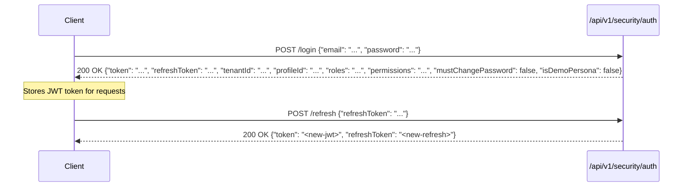

<!-- generated-by: gsd-doc-writer -->
# API Reference — ControlEasy Reborn

ControlEasy Reborn provides a RESTful API built on ASP.NET Core 8 minimal API endpoints. All API routes follow the `/api/v1/` prefix and exchange JSON payloads.

## Authentication & Authorization

All authenticated endpoints require an `Authorization: Bearer <token>` HTTP header containing a valid JSON Web Token (JWT).

### 1. Authentication Flow



`roles` and `permissions` are returned as strings; the `permissions` claim drives the permission-based authorization policies (`Permission_<Module>.<Action>`) enforced on individual endpoints. `mustChangePassword: true` requires the client to call `POST /api/v1/security/auth/change-password` before other operations.

### 2. Multi-Tenant Context
The active condominium is resolved by the `TenantResolutionMiddleware` from the `tenant_id` claim embedded within the JWT token (an optional `profile_id` claim identifies the attendant profile). Requests from users without the `PlatformAdmin` role that lack a `tenant_id` claim are rejected with `403 Forbidden` ("Tenant context required"). Platform operators switch context by calling `POST /api/v1/security/tenant-switch`, which issues a new token pair bound to the target tenant.

---

## Endpoint Catalog

### Authentication & Security (`/api/v1/security`)

| Method | Path | Description | Auth Required |
|---|---|---|---|
| `POST` | `/api/v1/security/auth/login` | Sign in with email and password | No |
| `POST` | `/api/v1/security/auth/forgot-password` | Request a password reset email; rate limited | No |
| `POST` | `/api/v1/security/auth/refresh` | Exchange a refresh token for a new access token | No |
| `POST` | `/api/v1/security/auth/change-password` | Change account password (required on first login); returns `204 No Content` | Yes |
| `GET` | `/api/v1/security/tenants?email=` | Look up tenants associated with an email (login-screen tenant picker) | No |
| `GET` | `/api/v1/security/session` | Get current session: tenant, roles, and switchable tenants | Yes |
| `POST` | `/api/v1/security/tenant-switch` | Switch active tenant context; returns a new token pair | Yes |
| `POST` | `/api/v1/security/users` | Register a new platform user | Yes (`PlatformAdminOnly`) |
| `POST` | `/api/v1/security/users/{userId}/reset-password` | Generate a temporary password for a user (PlatformAdmin or TenantAdmin role, enforced in handler) | Yes |
| `GET` | `/api/v1/security/attendant-profiles` | List attendant profiles for the active tenant | Yes |
| `GET` | `/api/v1/security/attendant-profiles/me` | Get attendant profile of the logged-in user | Yes |
| `POST` | `/api/v1/security/attendant-profiles` | Create a new attendant profile | Yes |
| `GET` | `/api/v1/security/attendant-profiles/{id}` | Get attendant profile details | Yes |
| `PUT` | `/api/v1/security/attendant-profiles/{id}` | Update attendant permissions and details | Yes |
| `POST` | `/api/v1/security/attendant-profiles/{id}/deactivate` | Deactivate an attendant profile | Yes |
| `GET` | `/api/v1/security/shifts` | List gatehouse work shifts | Yes |
| `POST` | `/api/v1/security/shifts` | Create a gatehouse work shift | Yes |
| `GET` | `/api/v1/security/gatehouses` | List physical gatehouses ("portarias") | Yes |
| `POST` | `/api/v1/security/gatehouses` | Register a physical gatehouse | Yes |

### Tenants Management (`/api/v1/tenants`)

The entire tenant management group (and tenant backups) requires the `PlatformAdminOnly` policy.

| Method | Path | Description | Auth Required |
|---|---|---|---|
| `GET` | `/api/v1/tenants` | List all condominiums/tenants | Yes (`PlatformAdminOnly`) |
| `POST` | `/api/v1/tenants` | Register a new condominium tenant | Yes (`PlatformAdminOnly`) |
| `GET` | `/api/v1/tenants/{id}` | Get details of a specific condominium | Yes (`PlatformAdminOnly`) |
| `POST` | `/api/v1/tenants/{id}/suspend` | Suspend tenant access | Yes (`PlatformAdminOnly`) |
| `POST` | `/api/v1/tenants/{id}/resume` | Resume suspended tenant | Yes (`PlatformAdminOnly`) |
| `GET` | `/api/v1/tenants/{id}/admins` | List tenant administrators for a condominium | Yes (`PlatformAdminOnly`) |
| `POST` | `/api/v1/tenants/{id}/admins` | Create or assign a tenant administrator | Yes (`PlatformAdminOnly`) |
| `PUT` | `/api/v1/tenants/{id}/admins/{userId}` | Update tenant administrator details | Yes (`PlatformAdminOnly`) |
| `POST` | `/api/v1/tenants/{id}/admins/{userId}/revoke` | Revoke administrator status; returns `204 No Content` | Yes (`PlatformAdminOnly`) |
| `POST` | `/api/v1/tenants/{id}/admins/{userId}/suspend` | Suspend a tenant administrator; returns `204 No Content` | Yes (`PlatformAdminOnly`) |
| `POST` | `/api/v1/tenants/{id}/admins/{userId}/resume` | Resume a suspended tenant administrator; returns `204 No Content` | Yes (`PlatformAdminOnly`) |
| `DELETE` | `/api/v1/tenants/{id}/admins/{userId}` | Delete a tenant administrator; returns `204 No Content` | Yes (`PlatformAdminOnly`) |
| `GET` | `/api/v1/tenants/{id}/porteiros` | List porteiros assigned to a condominium | Yes (`PlatformAdminOnly`) |
| `POST` | `/api/v1/tenants/{id}/porteiros` | Register a porteiro for a condominium | Yes (`PlatformAdminOnly`) |
| `PUT` | `/api/v1/tenants/{id}/porteiros/{userId}` | Update a porteiro | Yes (`PlatformAdminOnly`) |
| `POST` | `/api/v1/tenants/{id}/porteiros/{userId}/suspend` | Suspend a porteiro; returns `204 No Content` | Yes (`PlatformAdminOnly`) |
| `POST` | `/api/v1/tenants/{id}/porteiros/{userId}/resume` | Resume a suspended porteiro; returns `204 No Content` | Yes (`PlatformAdminOnly`) |
| `DELETE` | `/api/v1/tenants/{id}/porteiros/{userId}` | Delete a porteiro; returns `204 No Content` | Yes (`PlatformAdminOnly`) |
| `POST` | `/api/v1/admin/backups/{tenantId}` | Trigger tenant-specific database backup | Yes (`PlatformAdminOnly`) |

### Residents (`/api/v1/residents`)

| Method | Path | Description | Auth Required |
|---|---|---|---|
| `GET` | `/api/v1/residents` | List residents (supports `search`, `apartmentId`, pagination) | Yes |
| `POST` | `/api/v1/residents` | Register a new resident profile | Yes (`Permission_Residents.Write`) |
| `GET` | `/api/v1/residents/{id}` | Get resident details by ID | Yes |
| `PUT` | `/api/v1/residents/{id}` | Update resident information | Yes (`Permission_Residents.Write`) |

### Apartments & Units (`/api/v1/apartments`)

| Method | Path | Description | Auth Required |
|---|---|---|---|
| `GET` | `/api/v1/apartments` | List condominium apartments (supports `search`, pagination) | Yes |
| `POST` | `/api/v1/apartments` | Register a new apartment unit | Yes (`Permission_Apartments.Write`) |
| `GET` | `/api/v1/apartments/{id}` | Get apartment details | Yes |
| `PUT` | `/api/v1/apartments/{id}` | Update apartment configuration | Yes (`Permission_Apartments.Write`) |

### Visits & Gatehouse Operations (`/api/v1/visits`)

| Method | Path | Description | Auth Required |
|---|---|---|---|
| `GET` | `/api/v1/visits` | List visitor records (filter by `status`, paginated) | Yes |
| `POST` | `/api/v1/visits` | Create a new visit record | Yes |
| `GET` | `/api/v1/visits/{id}` | Get visit details | Yes |
| `POST` | `/api/v1/visits/{id}/checkin` | Record visitor gatehouse check-in | Yes |
| `POST` | `/api/v1/visits/{id}/checkout` | Record visitor gatehouse check-out | Yes |

### Vehicles (`/api/v1/vehicles`)

| Method | Path | Description | Auth Required |
|---|---|---|---|
| `GET` | `/api/v1/vehicles` | List vehicles (supports `search`, pagination) | Yes |
| `POST` | `/api/v1/vehicles` | Register a vehicle | Yes |
| `GET` | `/api/v1/vehicles/{id}` | Get vehicle registration details | Yes |
| `PUT` | `/api/v1/vehicles/{id}` | Update vehicle details | Yes |

### Service Providers (`/api/v1/service-providers`)

| Method | Path | Description | Auth Required |
|---|---|---|---|
| `GET` | `/api/v1/service-providers` | List authorized service providers and contractors | Yes |
| `POST` | `/api/v1/service-providers` | Register service provider profile | Yes (`Permission_ServiceProviders.Write`) |
| `GET` | `/api/v1/service-providers/{id}` | Get service provider details | Yes |
| `PUT` | `/api/v1/service-providers/{id}` | Update service provider details | Yes (`Permission_ServiceProviders.Write`) |
| `POST` | `/api/v1/service-providers/{id}/deactivate` | Deactivate a service provider | Yes (`Permission_ServiceProviders.Write`) |

### Photos, Consent Policies & Entry Log (`/api/v1/photos`, `/api/v1/consent-policy`, `/api/v1/entry-log`)

| Method | Path | Description | Auth Required |
|---|---|---|---|
| `POST` | `/api/v1/photos` | Upload client-resized photo (multipart form or raw `image/*` body; 8 MB limit) | Yes (`Permission_Photos.Write`) |
| `GET` | `/api/v1/photos?entityType=&entityId=` | List photos bound to an entity | Yes (`Permission_Photos.Read`) |
| `GET` | `/api/v1/photos/{id}` | Retrieve stored photo binary | Yes (`Permission_Photos.Read`) |
| `DELETE` | `/api/v1/photos/{id}` | Soft-delete a photo; returns `204 No Content` | Yes (`Permission_Photos.Delete`) |
| `GET` | `/api/v1/consent-policy/{subjectCategory}` | Get the tenant consent policy for a subject category | Yes (`Permission_Photos.Read`) |
| `PUT` | `/api/v1/consent-policy` | Update tenant-wide photo consent settings | Yes (`Permission_Photos.Write`) |
| `POST` | `/api/v1/entry-log` | Append entry log with photo and consent audit | Yes (`Permission_Photos.Write`) |
| `GET` | `/api/v1/entry-log` | List entry logs (filter by `entryState`, `subjectType`, date range) | Yes (`Permission_Photos.Read`) |
| `GET` | `/api/v1/entry-log/export` | Export entry log as CSV (`text/csv`) | Yes (`Permission_Photos.Read`) |

### Reports & Dashboard (`/api/v1/reports`, `/api/v1/dashboard`)

| Method | Path | Description | Auth Required |
|---|---|---|---|
| `GET` | `/api/v1/reports/visit-counts-by-day` | Visit counts aggregated per day (`from`/`to` date filters) | Yes |
| `GET` | `/api/v1/reports/history` | Paginated visit history (filters: `status`, `carrierCode`, `q`, `apartmentId`, date range); returns `X-Total-Count` header | Yes |
| `GET` | `/api/v1/reports/residents-per-apartment` | Resident counts grouped by apartment | Yes |
| `GET` | `/api/v1/dashboard/stats` | Real-time statistics (active visitors, residents, shifts) | Yes |

### Administration (`/api/v1/administration`)

Condominium settings, audit logs, and legacy key/value configurations. All endpoints require authentication (group-level policy; no additional permission policies).

| Method | Path | Description | Auth Required |
|---|---|---|---|
| `GET` | `/api/v1/administration/settings` | Get condominium settings for the active tenant | Yes |
| `PUT` | `/api/v1/administration/settings` | Update condominium settings (records acting user) | Yes |
| `GET` | `/api/v1/administration/audit-logs` | List audit logs (filters: `category`, `severity`, `entityType`, `action`, date range, `searchTerm`) | Yes |
| `GET` | `/api/v1/administration/audit-logs/{id}` | Get an audit log entry by ID | Yes |
| `POST` | `/api/v1/administration/audit-logs` | Create an audit log entry | Yes |
| `GET` | `/api/v1/administration/audit-logs/entity/{entityId}` | List audit log entries for an entity | Yes |
| `GET` | `/api/v1/administration/configurations` | List configuration entries (paginated) | Yes |
| `GET` | `/api/v1/administration/configurations/{id}` | Get a configuration entry by ID | Yes |
| `GET` | `/api/v1/administration/configurations/key/{key}` | Get a configuration entry by key | Yes |
| `POST` | `/api/v1/administration/configurations` | Create a configuration entry | Yes |
| `PUT` | `/api/v1/administration/configurations/{id}` | Update a configuration entry | Yes |

### Access Control (`/api/v1/access-*`)

QR credential issuance and gatehouse access events (see `docs/access-control.md` for module internals). Refused scans return `422 Unprocessable Entity` with a `failureCode` extension (`invalid_credential`, `credential_inactive`, `subject_inactive`, `destination_required`, `destination_inactive`, `not_authorized`, `policy_action_required`, `vehicle_inactive`).

| Method | Path | Description | Auth Required |
|---|---|---|---|
| `GET` | `/api/v1/access-control/_meta` | Module scaffold metadata | Yes |
| `POST` | `/api/v1/access-events/scans` | Record an entrance/exit from a QR payload; idempotent on `(TenantId, ScanAttemptId)` | Yes (`Permission_Access.Access.Operate`) |
| `GET` | `/api/v1/access-events` | List accepted access events (filters: date range, direction, subject, credential status, gatehouse, attendant; `take` max 200) | Yes (`Permission_Access.Read`) |
| `GET` | `/api/v1/access-events/refused-attempts` | List refused scan attempts (refusal lens) | Yes (`Permission_Access.Read`) |
| `POST` | `/api/v1/access-events/manual` | Record a manual access event bound to a prior lookup audit (supports package-delivery kind with `packageDescription`/`packageCarrierCode`) | Yes (`Permission_Access.Access.Operate`) |
| `POST` | `/api/v1/access-subjects/search` | Protected manual lookup; returns masked documents and result-count band only | Yes (`Permission_Access.Access.Operate`) |
| `POST` | `/api/v1/access-credentials` | Issue a QR credential; QR payload returned once (`oneTimeDisplay: true`) | Yes (`Permission_Access.Control.Issue`) |
| `GET` | `/api/v1/access-credentials` | List credentials (filters: `subjectType`, `subjectId`, `status`; `take` max 200) | Yes (`Permission_Access.Read`) |
| `GET` | `/api/v1/access-credentials/{id}` | Get credential details (never exposes the raw QR) | Yes (`Permission_Access.Read`) |
| `POST` | `/api/v1/access-credentials/{id}/replace` | Atomically replace a credential; new QR payload returned once | Yes (`Permission_Access.Control.Replace`) |
| `POST` | `/api/v1/access-credentials/{id}/revoke` | Revoke a credential (idempotent for already-revoked) | Yes (`Permission_Access.Control.Revoke`) |

### System & Diagnostics

| Method | Path | Description | Auth Required |
|---|---|---|---|
| `GET` | `/health` | Health check probe (includes a database check) | No |
| `GET` | `/api/v1/health` | Health check probe (same checks, API-prefixed) | No |
| `GET` | `/api/v1/features` | List feature flags and their enabled state | Yes |
| `GET` | `/api/v1/demo/info` | Status of demo mode and sample seed (demo tenant list when enabled) | No |
| `POST` | `/api/v1/demo/reset` | Force demo data re-seed; returns `404` when demo mode is disabled, `204` on success | Yes (`PlatformAdminOnly`) |
| `GET` | `/api/v1/security/bootstrap` | Check PlatformAdmin bootstrap status (pending credentials) | No |

---

## Request/Response Formats

All endpoints exchange JSON (`application/json`) except photo uploads (multipart form or raw image bytes) and the entry-log export (`text/csv`). Requests are bound to immutable record DTOs defined per module (e.g., `LoginRequest(string Email, string Password)`).

Representative examples:

```json
// POST /api/v1/security/auth/login — request
{ "email": "operator@example.com", "password": "..." }
```

```json
// POST /api/v1/security/auth/login — 200 OK response
{
  "token": "<jwt>",
  "refreshToken": "<refresh-token>",
  "tenantId": "3f2504e0-4f89-11d3-9a0c-0305e82c3301",
  "profileId": "9d1b0e8c-2a34-4c5d-8f9a-1b2c3d4e5f60",
  "roles": "TenantAdmin",
  "permissions": "Residents.Read,Residents.Write",
  "mustChangePassword": false,
  "isDemoPersona": false
}
```

```json
// POST /api/v1/access-events/scans — 422 refused scan response
{
  "type": "https://httpstatuses.io/422",
  "title": "Access scan rejected",
  "status": 422,
  "detail": "credential_inactive",
  "failureCode": "credential_inactive",
  "decision": "refused"
}
```

---

## Error Handling (RFC 7807)

All non-2xx responses return a standard `ProblemDetails` object:

```json
{
  "type": "https://httpstatuses.io/400",
  "title": "Validation failed",
  "status": 400,
  "detail": "One or more validation errors occurred.",
  "errors": {
    "Email": ["The Email field is required."],
    "DocumentNumber": ["Invalid CPF/CNPJ format."]
  }
}
```

Validation failures from any module's `ValidationException` include an `errors` extension property keyed by field name.

### Standard Status Codes
- `200 OK` / `201 Created` — Successful operation.
- `204 No Content` — Successful operation with no body (password change, admin/porteiro revoke/suspend/resume/delete, photo delete, demo reset).
- `400 Bad Request` — Validation failure (`ValidationException`).
- `401 Unauthorized` — Missing, expired, or invalid JWT token.
- `403 Forbidden` — Insufficient user permissions/roles, or missing `tenant_id` claim for non-platform-admin callers.
- `404 Not Found` — Requested entity does not exist on the active tenant (`NotFoundException`); also returned by `POST /api/v1/demo/reset` when demo mode is disabled.
- `409 Conflict` — State conflict, unique key violation (`ConflictException`), or AccessControl credential lifecycle conflicts (`CredentialAlreadyActiveException`, `CredentialLifecycleConflictException`).
- `413 Payload Too Large` — Photo upload exceeds the 8 MB limit.
- `422 Unprocessable Entity` — Access scan rejected; `failureCode` extension identifies the reason.
- `429 Too Many Requests` — Rate limit exceeded (see Rate Limits).
- `500 Internal Server Error` — Unexpected unhandled exception.

## Rate Limits

The `forgot-password` policy applies to `POST /api/v1/security/auth/forgot-password` only: a fixed window of **3 requests per 15 minutes**, partitioned per request-email (parsed from the body, falling back to the `X-Reset-Email` header, then to the client IP). Exceeding the limit returns `429 Too Many Requests`. No other endpoints are rate limited.