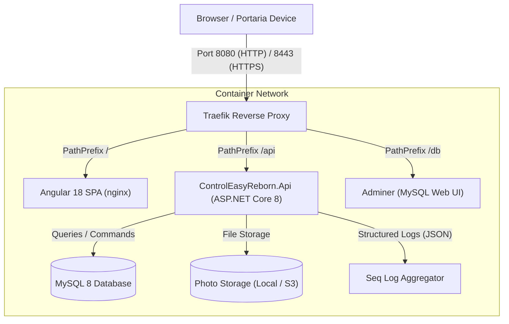
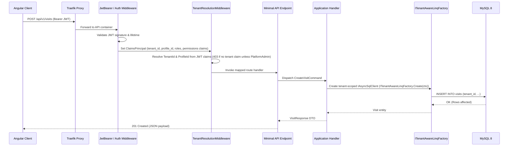

<!-- generated-by: gsd-doc-writer -->
# Architecture Overview — ControlEasy Reborn

This document describes the architectural style, component topology, data flows, and design invariants of ControlEasy Reborn.

## System Overview

ControlEasy Reborn is structured as a **modular monolith** with **Clean Architecture** and **vertical slices** implemented within each feature module. The application is hosted as an ASP.NET Core 8 minimal API service communicating with an Angular 18 Single Page Application (SPA), backed by MySQL 8 and orchestrated via Docker Compose.

### Architectural Invariants

1. **Modular Boundaries:** Each feature module lives under `src/Modules/<Module>/` and is divided into layers:
   - `Domain`: Pure domain entities and value objects. Zero external dependencies. (Exceptions: the Reports module has no `Domain` project — its read-model records live in `Application/Contracts` — and `AccessControl` defines its domain exceptions in its Domain layer.)
   - `Application`: Use-case handlers, DTOs, FluentValidation validators, repository interfaces (`Application/Abstractions`), and module domain exceptions (`Application/Errors`).
   - `Infrastructure`: Data persistence with DBTools, external service integrations, module-specific DI registration.
   - `Api`: Minimal API endpoint definitions (`MapGroup`), route registration, authorization policies.
2. **No Cross-Module Persistence References:** Modules never reference another module's persistence implementation directly. The intended pattern for cross-module reads is directory abstractions — e.g., the AccessControl module consumes `IResidentDirectory`, `IVehicleDirectory`, `IApartmentDirectory`, and `IVisitDirectory` — abstractions defined in the Application layer of the Residents, Vehicles, Apartments, and Visits modules respectively and implemented by each module's own Infrastructure repositories. In practice, a small number of Application-layer consumers (currently AccessControl's `AccessEventDestinationResolver`) additionally reference sibling modules' Domain entity types directly, and `AccessControl.Application` carries ProjectReferences to those modules' Application projects; keep new cross-module integrations on the directory-abstraction pattern.
3. **No Entity Framework Core (ADR 0002):** Persistence is implemented using [DBTools](https://www.nuget.org/packages/DBTools) 1.4.3 via its `IAsyncSqlClient` API (`SelectAsync` / `InsertAsync` / `UpdateAsync` with explicit field lists). Repositories call `IAsyncSqlClient` directly; raw SQL is reserved strictly for complex multi-table queries or stored procedures.
4. **Tenant Isolation:** Multi-tenancy is enforced at runtime. Tenant-scoped operations must use `ITenantAwareLinqFactory` to ensure no cross-tenant data leaks. Platform-level tables that intentionally have no tenant dimension — `Users`, `RefreshTokens`, `PasswordResetRequests` (Security), and `TenantAdmins` (Tenants) — are accessed via `IAsyncSqlClient` directly, without the tenant filter.
5. **No MediatR:** Handlers and services are registered as scoped services directly in DI and invoked without reflection-based mediator layers.
6. **Consistent Error Handling:** All errors return standard RFC 7807 `ProblemDetails` via a centralized ASP.NET Core `IExceptionHandler` (`GlobalExceptionHandler`).

## Component Diagram



## Module Structure

The application is decomposed into eleven feature modules and a shared kernel:

| Module | Purpose | Key Responsibilities |
|---|---|---|
| `Tenants` | Tenant Isolation | Condominium registration, tenant lifecycle, tenant administrator credentials, backup triggers |
| `Security` | Identity & Access | Users, BCrypt hashing, JWT issuance & refresh tokens, attendant profiles, shifts, gatehouse assignment |
| `Apartments` | Unit Management | Blocks, units, resident occupancy associations |
| `Residents` | Resident Registry | Resident contact details (email, phone), authorized unit members |
| `Vehicles` | Vehicle Registry | Vehicle registration, plate tracking, resident and unit association |
| `Visits` | Gatehouse Operations | Visitor registration, active visits, check-in, check-out timestamps |
| `ServiceProviders` | Contractor Access | Service provider registration, company records |
| `AccessControl` | Gatehouse Access Control | QR credential issuance, replacement, revocation & lifecycle actions; access scan decisions; manual access events; subject lookup (CPF/name/apartment) with audit trail; refused-scan attempts |
| `Photos` | Identity Capture | Gatehouse webcam/upload capture, client-side resizing, consent policy ledger, audit log |
| `Reports` | Analytics & Auditing | Access logs, attendance reports, dashboard statistics |
| `Administration` | System Operations | Condominium configuration, gatehouse settings, system parameters |
| `BuildingBlocks` | Shared Kernel & Infrastructure | Base primitives (`Result`, `Guard`, `DomainException`), `ITenantContext` contracts, tenant resolution middleware & DBTools tenant filter interceptor, `IStorageProvider` with Local/S3 providers, MailKit email, audit log contracts, feature flags, demo seeder & platform-admin bootstrap |

## Data Flow

### 1. HTTP Request Lifecycle



The middleware pipeline order is `UseAuthentication` → `TenantResolutionMiddleware` → `UseAuthorization` (registered in `src/Host/ControlEasyReborn.Api/Program.cs`).

### 2. Client-Side API Generation

To eliminate divergence between frontend models and backend DTOs:
1. ASP.NET Core endpoints are registered with Swagger/Swashbuckle (`AddSwaggerGen` / `UseSwagger` in `Program.cs`).
2. The Angular build pipeline executes `npm run openapi-gen` (`prebuild` hook) to convert the OpenAPI JSON spec (`http://localhost:8081/swagger/v1/swagger.json`, configured in `ng-openapi-gen.json`) into strongly-typed TypeScript API clients under `src/Web/ControlEasyReborn.Web/src/app/api/`.
3. `npm run openapi-check` re-generates the clients and fails on any `git diff` in `src/app/api`, guarding against client drift (used by the local CI verification suite).
4. Angular standalone components and signals consume these typed client services directly.

## Key Abstractions

### `ITenantAwareLinqFactory`
- **Location:** `src/BuildingBlocks/ControlEasyReborn.Infrastructure/MultiTenancy/TenantAwareLinqFactory.cs`
- **Role:** Produces instances of DBTools `AsyncSqlClient` pre-configured with the `TenantFilterInterceptor`, which appends a parameterized `tenant_id` predicate to every qualifying query. The interceptor is the single point where the global tenant filter is applied — repositories never add it themselves. Platform-level entities (e.g. the `Tenants` table) opt out via the `__bypassTenantFilter` query-interception property.

### `IStorageProvider`
- **Location:** `src/BuildingBlocks/ControlEasyReborn.SharedKernel/Storage/IStorageProvider.cs`
- **Role:** Storage abstraction (`SaveAsync` / `OpenReadAsync` / `DeleteAsync`) with two wired providers in `src/BuildingBlocks/ControlEasyReborn.Infrastructure/Storage/`: `LocalFilesystemStorageProvider` (default, writing to `./storage/photos` per `appsettings.json`) and `S3StorageProvider` (selected via `Storage:Provider = "S3"` for multi-node deployments). Configuration is validated at startup by `AddControlEasyStorage`, and the Photos module handlers consume the provider for capture uploads and retrieval.

### `TenantResolutionMiddleware`
- **Location:** `src/BuildingBlocks/ControlEasyReborn.Infrastructure/MultiTenancy/TenantResolutionMiddleware.cs`
- **Role:** Registered between `UseAuthentication` and `UseAuthorization`. Reads the `tenant_id` and `profile_id` claims plus `roles`/`permissions` claims from the authenticated `ClaimsPrincipal` and populates `ITenantContext` (backed by `HttpTenantContext`). If the request carries no `tenant_id` claim and the caller does not hold the `PlatformAdmin` role, it short-circuits with a `403` `ProblemDetails`-shaped response ("Tenant context required").

### Authorization Policies
- **Locations:**
  - `PlatformAdminRequirement` + `PlatformAdminAuthorizationHandler`: `src/Modules/Tenants/ControlEasyReborn.Modules.Tenants.Api/Auth/`
  - `RequirePermissionRequirement` + `RequirePermissionAuthorizationHandler`: `src/Modules/Security/ControlEasyReborn.Modules.Security.Api/Auth/`
  - Policy registration: `src/Host/ControlEasyReborn.Api/Program.cs` (`AddAuthorization`)
- **Role:** Implements fine-grained access control:
  - `PlatformAdminRequirement`: Restricts platform-level operations (such as creating new condominiums) to platform operators.
  - `RequirePermissionRequirement`: Enforces individual permission flags from the Security module's `Permissions.All` registry (e.g., `residents:read`, `visits:write`, `tenants:admin`), with one `Permission_<name>` policy registered per permission.

### `GlobalExceptionHandler`
- **Location:** `src/Host/ControlEasyReborn.Api/Program.cs` (defined at the bottom of the file; registered via `AddExceptionHandler<GlobalExceptionHandler>()`)
- **Role:** Implements ASP.NET Core's `IExceptionHandler` to intercept per-module domain exceptions — `NotFoundException` (404), `ValidationException` (400, with the validator errors attached as the `errors` extension), `ConflictException` (409), Security's `UnauthorizedException` (401) and `ForbiddenException` (403), and AccessControl's `CredentialAlreadyActiveException` / `CredentialLifecycleConflictException` (409) — and map them into RFC 7807 `ProblemDetails` responses. Unrecognized exceptions return `false` and fall through to the default 500 handling.

## Directory Structure Rationale

```
src/
├── Host/
│   └── ControlEasyReborn.Api/           # The composition root: wires DI, registers middleware, maps routes,
│                                        # hosts Swagger, health checks, and the platform-admin bootstrap service
├── Web/
│   └── ControlEasyReborn.Web/           # Angular frontend: standalone components, signals, Tailwind CSS, OpenAPI-generated API clients
├── BuildingBlocks/                      # Cross-cutting concerns shared across multiple modules
│   ├── ControlEasyReborn.SharedKernel/  # Zero-dependency contracts: Primitives (Result, Guard, DomainException),
│   │                                    # ITenantContext, IStorageProvider/StorageOptions, audit-log & email
│   │                                    # contracts, feature flags, bootstrap/demo option types
│   └── ControlEasyReborn.Infrastructure/# DBTools setup & DI, Multi-tenancy (TenantResolutionMiddleware,
│                                        # TenantAwareLinqFactory, TenantFilterInterceptor), storage providers
│                                        # (Local/S3), MailKit email sender, demo seeder, platform-admin bootstrap
└── Modules/                             # Bounded contexts with decoupled domain models
    └── <ModuleName>/
        ├── ControlEasyReborn.Modules.<Name>.Domain/
        ├── ControlEasyReborn.Modules.<Name>.Application/
        ├── ControlEasyReborn.Modules.<Name>.Infrastructure/
        └── ControlEasyReborn.Modules.<Name>.Api/
```

The `SharedKernel` project carries only abstractions and primitives so that every module (and the Host) can depend on it without pulling in runtime implementations; the `Infrastructure` project supplies the concrete DBTools wiring, tenant enforcement, and provider implementations that the Host registers at composition time.