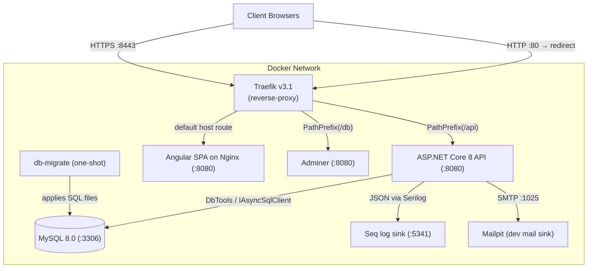

<!-- generated-by: gsd-doc-writer -->
# Deployment Guide — ControlEasy Reborn

This document details the production containerization, CI/CD deployment pipelines, environment configuration, storage persistence, and rollback strategies for ControlEasy Reborn.

## Deployment Targets & Topology

ControlEasy Reborn is deployed as a Docker Compose suite (`docker/docker-compose.yml`, project name `control_easy`). Compose is the only deployment target — there is no Kubernetes, Serverless, or PaaS configuration in the repository.

| Target | Config file | Purpose |
|---|---|---|
| Full stack (default) | `docker/docker-compose.yml` | api, web, db, db-migrate, reverse-proxy, adminer, mailpit, seq |
| Demo overlay | `docker/docker-compose.demo.yml` | Pre-populated data + fixed demo credentials. **Never for production.** |
| Per-worktree overlay | `docker/docker-compose.worktree.template.yml` | Isolated Compose project per git worktree |

The production images are built from two Dockerfiles:

- `docker/api.Dockerfile` — multi-stage: `dotnet/sdk:8.0` build → `aspnet:8.0` runtime, listens on port `8080`.
- `docker/web.Dockerfile` — multi-stage: `node:20-alpine` Angular production build → `nginx:alpine` runtime, listens on port `8080` (`docker/nginx.conf`), injects runtime config via `docker/40-runtime-config.sh`.

### Topology



Routing is defined in `docker/reverse-proxy/dynamic.yml`: HTTPS entrypoint only (HTTP redirects to HTTPS), with `Host(localhost)` / `HostRegexp(*.localhost)` matching and `PathPrefix(/api)` → api, `PathPrefix(/db)` → adminer, otherwise → web.

### Core Services

| Service | Image / Build Context | Role | Host Ports |
|---|---|---|---|
| `reverse-proxy` | `traefik:v3.1` | Edge reverse proxy, TLS termination, routing, dashboard | `127.0.0.1:${REVERSE_PROXY_PORT:-8080}:80`, `127.0.0.1:${REVERSE_PROXY_HTTPS_PORT:-8443}:8443`, `${REVERSE_PROXY_API_PORT:-8082}:8080` |
| `api` | Built via `docker/api.Dockerfile` | ASP.NET Core 8 minimal API runtime | `${API_PORT:-8081}:8080` |
| `web` | Built via `docker/web.Dockerfile` | Angular 18 static assets served via Nginx | Internal `8080` only (via Traefik) |
| `db` | `mysql:8.0` | Relational database engine (health-checked) | Internal `3306` |
| `db-migrate` | `mysql:8.0` (one-shot) | Applies `docker/mysql/migrations/*.sql` before `api` starts | none |
| `adminer` | `adminer:4` | Web database management tool, routed at `/db` | Internal `8080` |
| `mailpit` | `axllent/mailpit:latest` | Dev/test SMTP sink + web UI | `1025:1025`, `8025:8025` |
| `seq` | `datalust/seq:latest` | Structured log sink | Internal `5341` |

Note on the reverse-proxy port bindings: in the default Compose file the HTTP and HTTPS host ports are bound to loopback (`127.0.0.1`) for local development — change these bindings for hosted deployments, and set `REVERSE_PROXY_HTTPS_PORT` consistently (the Traefik `websecure` entrypoint listens on the *published* HTTPS port so redirect `Location` headers remain reachable).

---

## Build Pipeline & Continuous Integration

CI is defined in `.github/workflows/ci.yml` (workflow name: `ci`). It triggers on `pull_request` and `push` to `main`/`master`.

1. **`lint`** — Format, lint, and web unit tests:
   - `dotnet format src/ControlEasyReborn.sln --verify-no-changes --no-restore`
   - `npm ci --legacy-peer-deps` + `npm run lint` (in `src/Web/ControlEasyReborn.Web`)
   - Sets up headless Chromium via Playwright, then `npm test -- --no-watch --browsers=ChromeHeadlessNoSandbox`
2. **`build`** — Compile both stacks and verify the design-tokens contract:
   - `dotnet build src/ControlEasyReborn.sln`
   - `dotnet test tests/ControlEasyReborn.ArchitectureTests --filter TokensContract`
   - `npm run ng -- build --configuration production`
3. **`test-fast`** — Unit + architecture tests: `dotnet test` on `tests/ControlEasyReborn.UnitTests` and `tests/ControlEasyReborn.ArchitectureTests` (excluding the `TokensContract` filter, already run in `build`).
4. **`test-integration`** — `dotnet test tests/ControlEasyReborn.IntegrationTests` with real MySQL 8.0 containers via Testcontainers (the `mysql:8.0` image is cached between runs).
5. **`openapi`** — OpenAPI client drift check:
   - Boots the API in-process with dummy DB credentials and downloads `/swagger/v1/swagger.json`.
   - Runs `npx ng-openapi-gen` and enforces `git diff --exit-code -- src/app/api` (zero drift in generated TypeScript client).
6. **`docker`** — Image publishing to GHCR: builds and pushes `ghcr.io/<owner>/controleasy-api:<git-sha>` and `ghcr.io/<owner>/controleasy-web:<git-sha>` on pushes to `main`/`master`. **This job is currently disabled in the workflow file (`if: false`) and does not run.** <!-- VERIFY: whether the docker publish job should be re-enabled and the GHCR image naming for the actual production registry -->

The identical gate can be run locally without GitHub Actions:

```bash
./scripts/verify-ci-local.sh          # full 6-stage suite (all dotnet/npx steps run in Docker)
./scripts/verify-ci-local.sh --fast   # stages 1–3 only (format, build, unit+arch tests)
make verify-ci                        # same as full run
```

All dotnet/npx commands in the local gate execute inside Docker containers (`mcr.microsoft.com/dotnet/sdk:8.0`, `mcr.microsoft.com/dotnet/aspnet:8.0`, `node:20-slim`); only the Docker CLI is required on the host. A PowerShell equivalent exists at `scripts/verify-ci-local.ps1`.

---

## Production Environment Setup

### 1. Persistent Storage Volumes

The following named Docker volumes (defined in `docker-compose.yml`) must be mapped to persistent, backed-up host storage:

- `mysql-data`: Mounts to `/var/lib/mysql`. Holds all transactional tenant and platform data.
- `photos-data`: Mounts to `/storage/photos`. Stores visitor and resident identity capture files (when using `Storage__Provider=Local`).
- `traefik-data`: Mounts to `/letsencrypt` (Traefik's default ACME/TLS storage path). **No ACME resolver is currently configured** — TLS is served from local dev certificates mounted read-only at `/etc/traefik/certs` (see `docker/reverse-proxy/dynamic.yml`), so production certificate issuance must be wired up separately. <!-- VERIFY: production TLS strategy (Let's Encrypt / ACME resolver vs. external cert manager) -->
- `seq-data`: Mounts to `/data`. Holds indexed operational logs.

The `db` service also mounts `./mysql/init:/docker-entrypoint-initdb.d:ro` (schema + seed applied on first boot) and the `db-migrate` one-shot service mounts `./mysql/migrations:/migrations:ro`.

### 2. Environment Variables Checklist

Compose reads these from `docker/.env` (template: `docker/.env.example`); see [CONFIGURATION.md](CONFIGURATION.md) for the full reference:

```bash
# Security & Auth
JWT_SIGNING_KEY=<random-key-at-least-32-chars>   # compose default is a CHANGE-ME placeholder
ASPNETCORE_ENVIRONMENT=Production                # compose file hardcodes Development — override for production

# Database
MYSQL_ROOT_PASSWORD=<strong-root-password>       # compose default: controleasy_root_dev
MYSQL_USER=controleasy                           # compose default: controleasy
MYSQL_PASSWORD=<strong-app-password>             # compose default: controleasy_dev
# Note: MYSQL_DATABASE is hardcoded to controleasydb in docker-compose.yml (not parameterized).

# Networking (defaults shown; adjust for production host bindings)
REVERSE_PROXY_PORT=8080                          # HTTP entrypoint host port (loopback-bound by default)
REVERSE_PROXY_HTTPS_PORT=8443                    # HTTPS entrypoint host port (loopback-bound by default)
REVERSE_PROXY_API_PORT=8082                      # Traefik dashboard host port
API_PORT=8081                                    # Direct API host port (bypasses Traefik)

# Localization
TIME_ZONE=America/Sao_Paulo                      # applied to both api and web (nginx runtime config)

# Photo storage
STORAGE__PROVIDER=Local                          # or S3 (+ STORAGE__S3__* variables for MinIO/S3-compatible)
STORAGE__LOCAL__PATH=/storage/photos
```

Secrets (`JWT_SIGNING_KEY`, `MYSQL_ROOT_PASSWORD`, `MYSQL_PASSWORD`) must come from the deployment platform's secret manager in production — never commit a real `.env`. <!-- VERIFY: production secret-management mechanism (platform secret manager vs. Docker secrets) -->

---

## Health Checks & Monitoring

### Container Health Probes

- **API health endpoints:** `GET /health` and `GET /api/v1/health` (both mapped in `src/Host/ControlEasyReborn.Api/Program.cs`).
  - Registered check: `DbToolsHealthCheck` (tagged `database`) — pings MySQL through the DBTools tenant-aware factory.
  - Returns HTTP 200 when healthy; the check fails if the database is unreachable.
  - Note: only the `db` service has a Compose-level `healthcheck` (`mysqladmin ping` plus a schema-emptiness query). The `api` and `web` services have no container-level healthcheck — the database gate is enforced instead via `db-migrate` → `api` ordering (`depends_on: condition: service_completed_successfully`).
- **MySQL Health Check:** `mysqladmin ping --protocol=tcp` plus a table-count probe, configured in `docker-compose.yml` (5s interval, 30 retries, 30s start period).

### Observability

- **Structured logs:** Serilog writes to Console (JSON) and to Seq at `http://seq:5341` (configured via `Serilog__WriteTo__1__Args__serverUrl` in Compose). Inspect indexed logs in the Seq UI (internal port `5341`; not published to the host by default).
- **Traefik dashboard:** reachable at host port `8082` (`--api.insecure=true`). It is unauthenticated in the shipped config — protect it before exposing. <!-- VERIFY: production Traefik dashboard access control (basic auth / IP allowlist) -->
- **Database inspection:** Adminer at `https://<host>:8443/db` via Traefik.
- **Email capture:** Mailpit UI at host port `8025` (SMTP sink on `1025`).
- No external monitoring services (Sentry, Datadog, New Relic) are integrated; observability is entirely self-hosted via the services above.

---

## Rollback Procedure

If an unexpected regression or deployment defect occurs:

1. **Roll Back Container Images:**
   Re-deploy the previous known-healthy image tag. Since the CI publish job is disabled, images are built from the local Dockerfiles — tag and retain each release build, then pin the rollback in Compose:
   ```bash
   docker compose -f docker/docker-compose.yml build api web
   docker compose -f docker/docker-compose.yml up -d --force-recreate api web
   ```
   To restore an older build, retag the previously saved image (or `docker build` from the earlier commit) and recreate.
2. **Database Rollback:**
   - Schema migrations (`docker/mysql/migrations/*.sql`) are applied by the `db-migrate` one-shot service on every stack start; they are designed to be additive/idempotent across releases.
   - For major disaster recovery, restore from a tenant backup: the API exposes `POST /api/v1/admin/backups/{tenantId}` (PlatformAdmin authorization required), which creates a `mysqldump | gzip` snapshot written as `{timestamp}.sql.gz` under the `Backup:Path` configuration value (default `./backups/tenants/<tenant-slug>/`). Restore by piping the `.sql.gz` file back into MySQL:
     ```bash
     gunzip < <backup-file>.sql.gz | mysql --protocol=tcp -h 127.0.0.1 -u<user> -p <database>
     ```
   - As a last resort, the `mysql-data` volume itself can be restored from host-level backups (`docker compose down`, restore volume data, `docker compose up -d`).